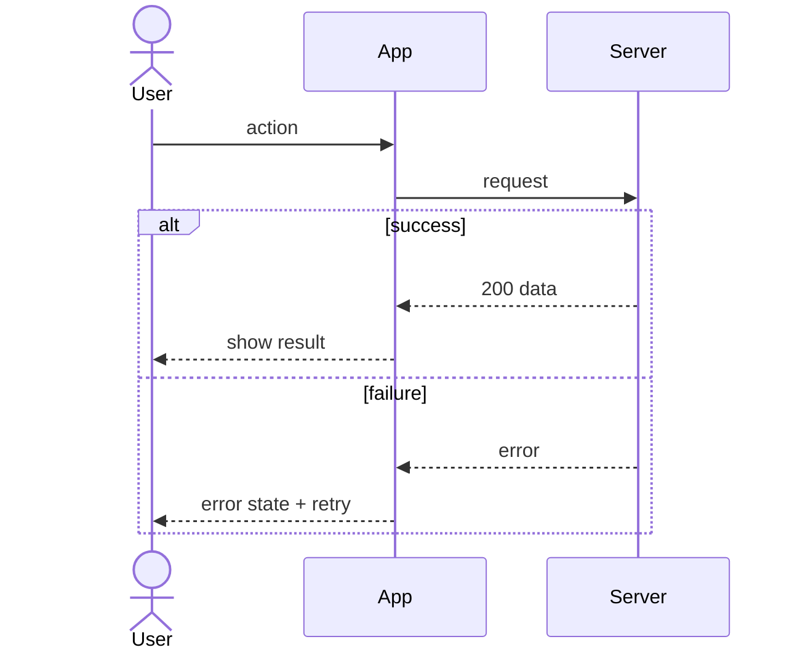

# AFD: <product> app flows

<!-- "AFD" (Application Flow Document) is Groundwork's name, not a standard. Each flow is a use case in Alistair Cockburn's "fully dressed" style ("Writing Effective Use Cases", 2001), drawn with UML 2.5.1 sequence/activity diagrams or BPMN 2.0 for multi-actor swimlanes. -->

One section per flow that branches or involves more than one actor, plus **system flows** (background jobs, polling, sync, pipelines). Link each flow to its FSD feature and REQ IDs. For an existing codebase, anchor each step to the code (`file` / function).

## Flow index
| ID | Flow | Actors | Trigger | REQ / FSD |
|---|---|---|---|---|
| AF-01 | | | | |

## AF-01 <name> (REQ-001, F1)
- Primary actor: <who wants the goal> · Secondary actors: <systems, services, other people>
- Trigger: <what starts it>
- Preconditions: <signed in, online, permission granted…>
- Code: <entry point, e.g. `src/handlers/login.rs` `handle_login`> (existing projects)

**Main success scenario**
1. <actor> does …
2. System …
3. …

**Extensions** (numbered by the step they branch from)
- 2a. <condition, e.g. offline>: 1. System shows …; 2. returns to step 2 when …
- 3a. <condition>: …

- Check the extensions cover: timeout, offline, no permission, duplicate submit, cancel midway
- **Success guarantee:** <what is true when the goal is reached>
- **Minimal guarantee:** <what stays true even when it fails, e.g. "no double charge", "draft is kept">

## System flows
### AF-9x <background job / state engine / release pipeline>
<trigger, schedule, steps, retries, what the user sees when it fails>
