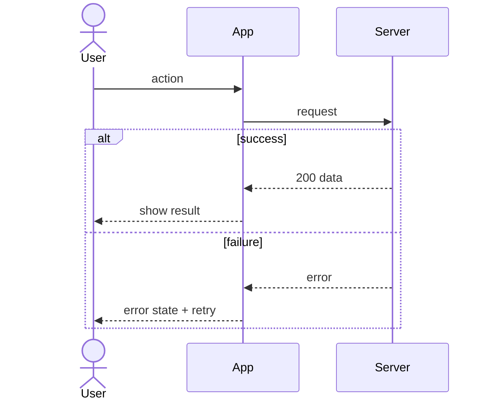

# AFD: <product> app flows

One section per flow that branches or involves more than one actor, plus **system flows** (background jobs, polling, sync, pipelines). Link each flow to its FSD feature and REQ IDs. For an existing codebase, anchor each step to the code (`file` / function).

## Flow index
| ID | Flow | Actors | Trigger | REQ / FSD |
|---|---|---|---|---|
| AF-01 | | | | |

## AF-01 <name> (REQ-001, F1)
- Actors: <user, admin, system, external service>
- Trigger: <what starts it>
- Preconditions: <signed in, online, permission granted…>
- Code: <entry point, e.g. `src/handlers/login.rs` `handle_login`> (existing projects)

- Error and edge paths: timeout, offline, no permission, duplicate submit, cancel midway
- End states: <what is true when the flow finishes, for each path>

## System flows
### AF-9x <background job / state engine / release pipeline>
<trigger, schedule, steps, retries, what the user sees when it fails>
