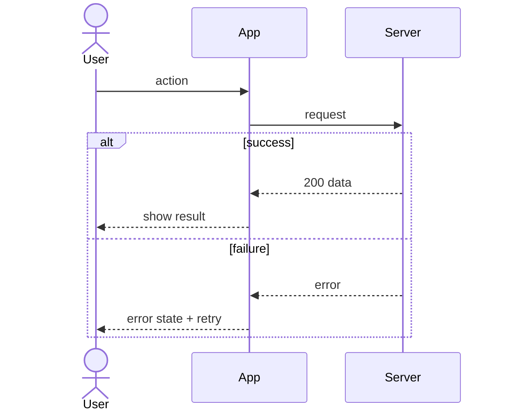

# AFD: <product> app flows

One section per flow that branches or involves more than one actor. Link each flow to its FSD feature and REQ IDs.

## Flow: <name> (REQ-001, AC-001)
- Actors: <user, admin, system, external service>
- Trigger: <what starts it>
- Preconditions: <signed in, online, permission granted…>

- Error and edge paths: timeout, offline, no permission, duplicate submit, cancel midway
- End states: <what is true when the flow finishes, for each path>
