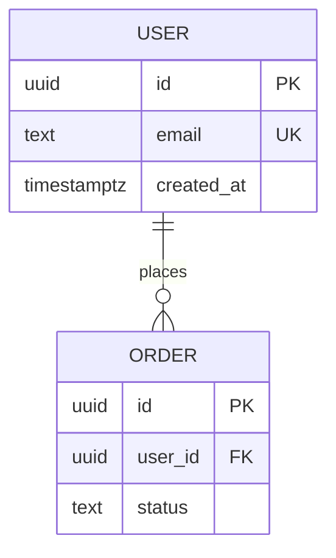

# BSD: <product> backend specification

Contracts the client and server agree on. The API's source of truth is `docs/contracts/openapi.yaml` (or a GraphQL/proto schema); this doc explains it.

## API conventions
- Base URL and versioning: <e.g. /api/v1, breaking change → v2>
- Auth: <session cookie / bearer token / API key>; how tokens expire and refresh
- Error format: <e.g. RFC 9457 problem+json: type, title, status, detail>
- Pagination, filtering, sorting: <cursor or page>
- Rate limits and idempotency: <which endpoints, Idempotency-Key header>

## Endpoints
| Method | Path | Purpose | Auth / role | REQ |
|---|---|---|---|---|

## Database schema

| Table | Purpose | Key columns | Indexes | Personal data? (SRD) |
|---|---|---|---|---|

## Migrations
- Tool: <prisma / alembic / flyway / …>; every schema change is a migration file in the repo.
- Breaking changes use expand → migrate data → contract, never a destructive one-step change.
- Backup and restore plan before running migrations in production.

## Background jobs and events
| Job / event | Trigger | Retries | What happens on failure |
|---|---|---|---|
