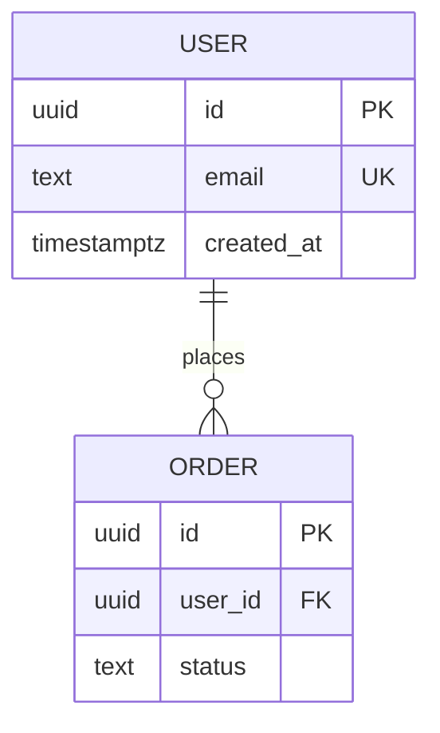

# BSD: <product> backend specification

<!-- "BSD" is Groundwork's name for the backend/API specification (not the BSD licence). Sources: OpenAPI 3.2 (2025) for HTTP APIs, AsyncAPI 3 for events, RFC 9457 problem details for errors, ER modelling (Chen, 1976) for data. -->

Contracts between the parts of the system: client and server, or in a desktop or mobile app the UI and the main process (IPC), and the app and its helper processes. No server or database? Use the same sections: IPC channels go in Endpoints, local files and stores in Data storage, helper processes in Background jobs. Sources of truth: `docs/contracts/openapi.yaml` (OpenAPI 3.1 or 3.2; state which), `docs/contracts/asyncapi.yaml` for events and queues, or a GraphQL/proto schema. This doc explains them.

## API conventions
- Base URL and versioning: <e.g. /api/v1, breaking change → v2>
- Auth: <session cookie / bearer token / API key>; how tokens expire and refresh
- Error format: RFC 9457 problem+json: `type` (a URI from the list below), `title`, `status`, `detail`, `instance`, plus documented extension members
- Compatibility and deprecation: <what counts as breaking (removing or renaming fields, tightening validation, changing meaning); how long old versions live; `Deprecation` and `Sunset` (RFC 8594) headers>
- Pagination, filtering, sorting: <cursor or page>
- Rate limits and idempotency: <which endpoints, Idempotency-Key header>

## Roles and permissions
| Role | Endpoints / actions allowed |
|---|---|

## Endpoints
| Interface (HTTP method + path, IPC channel, CLI command, socket) | Purpose | Caller and auth / role | REQ |
|---|---|---|---|

## Data storage
A database: the diagram and table list below. Local storage only (files, key-value stores, caches): the table in Files, logs and other formats.

| Table | Purpose | Key columns | Indexes | Personal data? (SRD) |
|---|---|---|---|---|

## Migrations
- Tool: <prisma / alembic / flyway / …>; every schema change is a migration file in the repo.
- Breaking changes use expand → migrate data → contract, never a destructive one-step change.
- Backup and restore plan before running migrations in production.

## Files, logs and other formats
| File / stream | Format | Written by | Retention | Integrity (append-only, signed…) |
|---|---|---|---|---|
<e.g. an audit log: one JSON object per line, fields and meaning>

## Other protocols
<non-HTTP interfaces: sockets, CLI, loopback admin, message queues: framing, auth, errors>

## Error types
| `type` URI | When | HTTP status |
|---|---|---|

## Background jobs, helper processes and events
| Job / process / event (AsyncAPI channel) | Trigger or who starts it | Payload or arguments | Retries / restart | What happens on failure |
|---|---|---|---|---|
