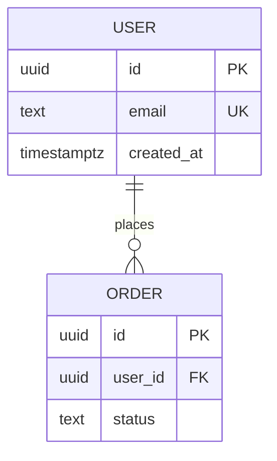

# BSD: <product> backend specification

<!-- "BSD" is Groundwork's name for the backend/API specification (not the BSD licence). Sources: OpenAPI 3.2 (2025) for HTTP APIs, AsyncAPI 3 for events, RFC 9457 problem details for errors, ER modelling (Chen, 1976) for data. -->

Contracts the client and server agree on. Sources of truth: `docs/contracts/openapi.yaml` (OpenAPI 3.1 or 3.2; state which), `docs/contracts/asyncapi.yaml` for events and queues, or a GraphQL/proto schema. This doc explains them.

## API conventions
- Base URL and versioning: <e.g. /api/v1, breaking change → v2>
- Auth: <session cookie / bearer token / API key>; how tokens expire and refresh
- Error format: RFC 9457 problem+json: `type` (a URI from the list below), `title`, `status`, `detail`, `instance`, plus documented extension members
- Compatibility and deprecation: <what counts as breaking (removing or renaming fields, tightening validation, changing meaning); how long old versions live; `Deprecation` and `Sunset` (RFC 8594) headers>
- Pagination, filtering, sorting: <cursor or page>
- Rate limits and idempotency: <which endpoints, Idempotency-Key header>

## Roles and permissions
| Role | Endpoints / actions allowed |
|---|---|

## Endpoints
| Method | Path | Purpose | Auth / role | REQ |
|---|---|---|---|---|

## Database schema

| Table | Purpose | Key columns | Indexes | Personal data? (SRD) |
|---|---|---|---|---|

## Migrations
- Tool: <prisma / alembic / flyway / …>; every schema change is a migration file in the repo.
- Breaking changes use expand → migrate data → contract, never a destructive one-step change.
- Backup and restore plan before running migrations in production.

## Files, logs and other formats
| File / stream | Format | Written by | Retention | Integrity (append-only, signed…) |
|---|---|---|---|---|
<e.g. an audit log: one JSON object per line, fields and meaning>

## Other protocols
<non-HTTP interfaces: sockets, CLI, loopback admin, message queues: framing, auth, errors>

## Error types
| `type` URI | When | HTTP status |
|---|---|---|

## Background jobs and events
| Job / event (AsyncAPI channel) | Trigger | Payload schema | Retries | What happens on failure |
|---|---|---|---|---|
