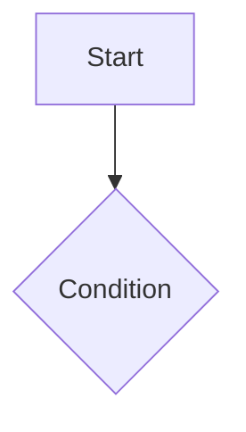

# FSD: <product>

## Feature: <name> (REQ-001, REQ-002)
- Description:
- Acceptance criteria (Given / When / Then):
  - AC-001: Given ..., when ..., then ...
- States & errors: empty, loading, error, offline, no permission
- Flow:

- Dependencies / exclusions:
