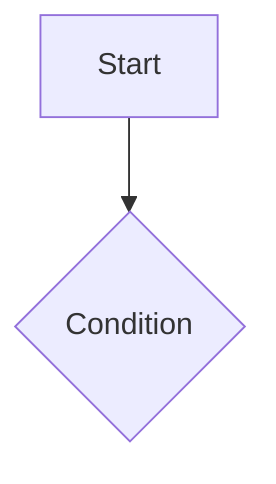

# FSD: <product>

<!-- Lineage: Joel Spolsky, "Painless Functional Specifications" (2000); the formal counterpart is the SRS in ISO/IEC/IEEE 29148. Behaviour from the user's view; technical design goes to the TRD. -->
- Owner: <one named author> · Status: draft | reviewed | approved · Updated: <date>

## Overview
<one paragraph: what this spec covers>

## Scenarios
Short stories of real users doing real tasks, the core device of a functional spec:
- **<persona>** <wants to …>. They open …, see …, tap …, and end up with ….

## Non-goals
- <what this spec deliberately does not cover>

What every feature does, precisely enough to build and test it. Link each feature to its PRD IDs.
**Large projects:** split into `docs/fsd/00-conventions.md` + `docs/fsd/sections/<nn>-<area>.md` + an index file holding the traceability table below.

## Part 0: conventions (shared by every feature and screen)
- **Screen spec layout:** every screen below uses: purpose · entry points · layout · fields (name, type, validation, default) · actions · states · errors · permissions
- **Shared components:** <tables, forms, dialogs, toasts…, and how they behave everywhere>
- **Dialog kinds:** <confirm / destructive / form / info: when each is used>
- **Validation and errors:** <inline vs summary, message style: what happened + what to do>
- **Roles and permissions:**
  | Role | Can | Cannot |
  |---|---|---|
- **Scenario IDs:** acceptance scenarios are `AC-<feature>-<n>` (tests reference them)

## F1 <feature name> (REQ-001, REQ-002)
- Description:
- Acceptance criteria (Given / When / Then):
  - AC-F1-1: Given …, when …, then …
- States and errors: empty, loading, error, offline, no permission, long content
- Screens: <screen specs using the Part 0 layout, or links to the mockup>
- Flow: see AFD AF-xx

- Dependencies / exclusions:

## Traceability: PRD to FSD
| PRD ID | FSD feature / section | AC IDs | Mockup screen |
|---|---|---|---|

## Reconciliation decisions
<conflicts found between PRD, research and mockup while writing this, and how they were resolved>

## Open issues (and points for the TRD)
- <technical questions the functional spec raised>
